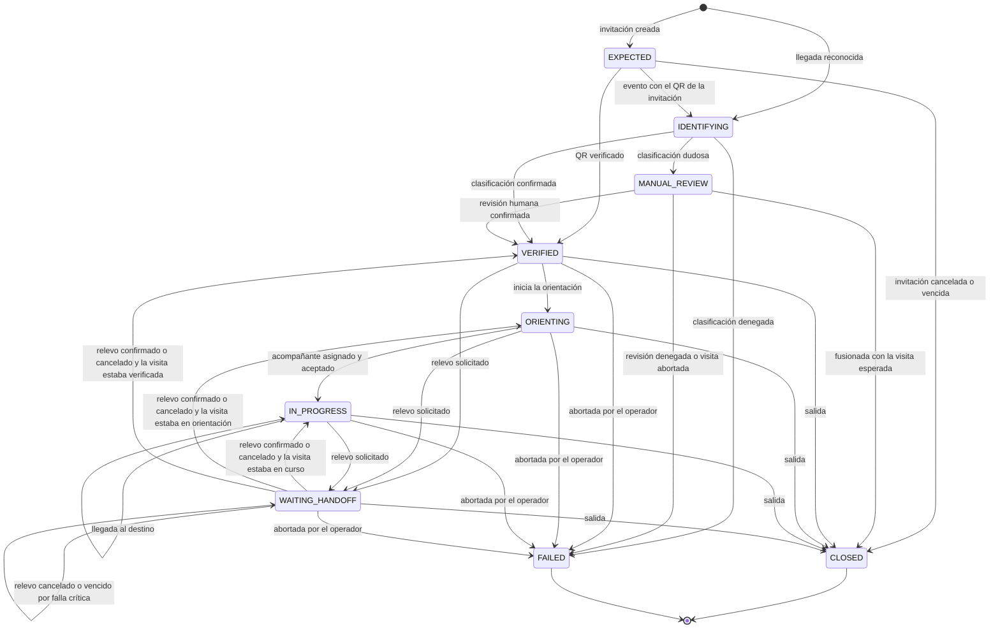
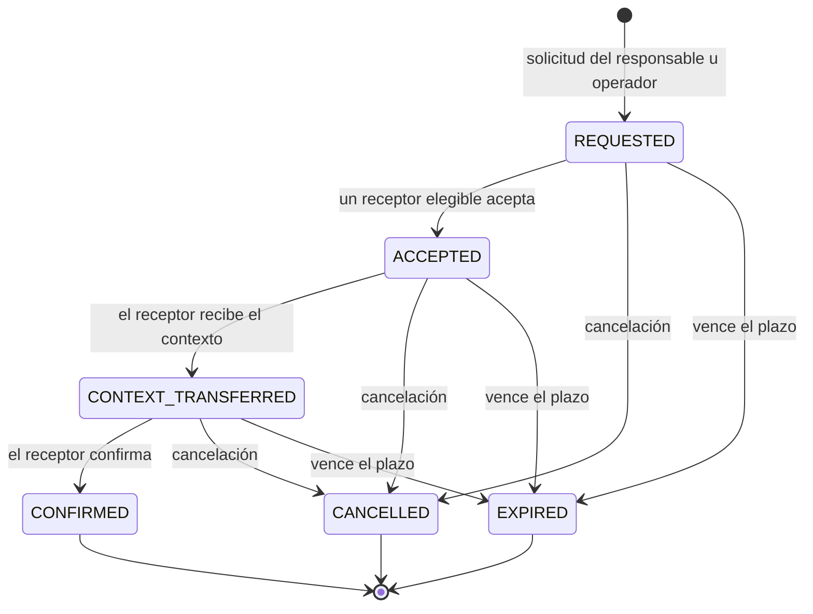

# ADR 0004: QR de invitación, máquinas de estado de visita y relevo, y concurrencia

- Estado: aceptada
- Fecha: 2026-10-23
- Relacionadas: ADR 0002 (almacén), ADR 0003 (clasificación), `docs/domain/invitations-qr.md`, `docs/domain/visit-handoff-states.md` (tablas completas y plan de pruebas)

## Contexto

Dos mecanismos concentran el riesgo de la demostración: el QR, que permite entrar a un invitado sin cuenta, y el relevo robot-humano, que traspasa la responsabilidad de una visita. Ambos deben resistir reutilización, manipulación, carreras entre dos edecanes y pérdida de conexión, y deben decidirse en el servidor, no en la interfaz.

## Decisión

### 1. QR: token opaco con registro en el servidor

- El QR contiene únicamente un token aleatorio: 16 bytes (128 bits) de un generador criptográfico, codificados en base64url (22 caracteres). No lleva nombre, fecha, anfitrión ni ningún dato personal, y no es una firma ni una estructura autodescriptiva.
- Toda la información vive en el servidor. El índice `qr:<token>` apunta a la visita; la invitación embebida en esa visita guarda `validFrom`, `validTo`, `usedAt` y `revokedAt`.
- Emisión: el token se genera, se registra con `compareAndSet` (crear si no existe) y, si hubiese colisión, se genera otro.
- Validez (se evalúa siempre en este orden): desconocido → revocado → ya usado → antes de `validFrom` → desde `validTo`. El intervalo es de inicio inclusivo y fin exclusivo, en hora de Bogotá.
- Un solo uso: el QR se consume cuando la visita pasa a `VERIFIED` por esa invitación. La invitación pasa a `USED` en la misma escritura que cambia la visita.
- Revocación: cancelar la invitación (`POST /invitations/{id}/cancel`) la deja en `CANCELLED` y el QR queda revocado.
- Las dos puertas de entrada (campo `qrToken` de un evento de reconocimiento y `POST /access/verify`) usan la misma función de verificación.
- Un QR válido es una credencial al portador: quien lo presenta es tratado como el invitado. La mitigación es de un solo uso, ventana corta y revocación; la comprobación de identidad proporcional queda en manos de recepción cuando el rostro no coincide (ADR 0003, revisión manual).

Riesgos aceptados en la demostración (se elevan a revisión de seguridad): sin autenticación real, quien conozca el identificador de un socio puede listar sus invitaciones y leer los tokens; las escrituras públicas solo tienen límite de tasa; el token de robot (`CERBERUS_ROBOT_TOKEN`) es opcional y solo protege los tres endpoints del robot. La consulta del pase (`GET /passes/{token}`) no pide actor: poseer el token es la credencial. Los datos son ficticios.

### 2. Máquina de estados de la visita

`IDENTIFYING` queda registrado en el historial de la visita y se persiste junto con el resultado de la clasificación en una sola escritura. Además, cualquier visita abierta de un día anterior (calendario de Bogotá) pasa a `CLOSED` con motivo `DAY_ROLLOVER`; no se dibuja para no saturar el diagrama.

### 3. Máquina de estados del relevo

El responsable de la visita (`ownerId`) cambia únicamente al llegar a `CONFIRMED`. La solicitud, la aceptación y la transferencia de contexto no lo modifican.

### 4. Cuándo cambia el responsable

`ownerId` cambia en solo dos transiciones: la asignación inicial de acompañante (`ASSIGN_ESCORT`, que exige la aceptación del visitante) y la confirmación de un relevo. Antes de la confirmación, el responsable original sigue siéndolo aunque ya exista un receptor que aceptó.

Cada relevo tiene un motivo. Los motivos críticos (`ROBOT_FAILURE`, `NETWORK_LOSS`, `LOW_BATTERY`) mantienen la visita en `WAITING_HANDOFF` si el relevo se cancela o vence, porque el responsable original no puede continuar; la visita queda sin relevo abierto y se puede solicitar otro. Los no críticos (`VISITOR_PREFERENCE`, `OPERATIONAL`) devuelven la visita a su estado previo.

### 5. Concurrencia e idempotencia

- **Un registro por visita.** El agregado `visit:<id>` contiene la invitación, el historial y los relevos. Cada transición de visita, relevo o invitación es una única escritura `compareAndSet` con la versión leída. Si falla, se relee y se reevalúa una vez; si la regla ya no se cumple, la respuesta es el error que corresponde al estado actual.
- **Dos aceptaciones simultáneas.** Las dos leen `REQUESTED` con la misma versión; la primera escritura gana y la segunda relee, ve `ACCEPTED` por otro actor y recibe 409 `HANDOFF_ALREADY_ACCEPTED`. El resultado no depende del orden ni deja escrituras parciales. Desactivar un botón en la interfaz no sustituye esta garantía.
- **Repeticiones.** Aceptar de nuevo con el mismo actor y confirmar de nuevo con el mismo receptor devuelven 200 con la misma representación, sin efectos nuevos. `Idempotency-Key` cubre además los POST que crean recursos (ADR 0002).
- **Falla de un robot.** `POST /robots/{id}/failure` marca el robot en `FAULT` y crea un relevo por cada visita abierta que le pertenezca. Cada visita es atómica; el lote no lo es, así que el endpoint es idempotente y reanudable: repetirlo completa las visitas pendientes.
- **Plazos.** Un relevo `REQUESTED` vence a los 300 s; uno `ACCEPTED` o `CONTEXT_TRANSFERRED`, a los 600 s desde la aceptación. El vencimiento se aplica de forma perezosa al leer o escribir, sin tareas programadas.
- **Fusión de una revisión con la visita esperada.** Cuando un QR válido se presenta para una visita en `MANUAL_REVIEW` que no es la de la invitación, primero se confirma la visita esperada (punto de compromiso) y después se cierra la de revisión con motivo `MERGED`. Si el segundo paso falla, esa visita queda en revisión sin conceder nada y la cierra el operador.

### 6. Invariantes

Se numeran para que cada una tenga una prueba (ver el plan de pruebas en `docs/domain/visit-handoff-states.md`).

- INV-01. El responsable cambia solo en `ASSIGN_ESCORT` y en la confirmación del relevo.
- INV-02. Un relevo en cualquier estado distinto de `CONFIRMED` no modifica el responsable.
- INV-03. Una visita tiene como máximo un relevo abierto.
- INV-04. De dos aceptaciones simultáneas gana exactamente una; la otra recibe 409.
- INV-05. Confirmar y aceptar son idempotentes para el mismo actor.
- INV-06. Los estados terminales no tienen salidas.
- INV-07. Solo un receptor elegible acepta; solo el receptor aceptante recibe el contexto y confirma.
- INV-08. No se llega a `VERIFIED` sin clasificación confirmada, QR verificado o revisión humana revalidada.
- INV-09. El rostro nunca confirma por sí solo (ADR 0003, F-1).
- INV-10. Un QR se consume una sola vez, en la misma escritura que verifica la visita.
- INV-11. Una visita es un registro; cada transición es una escritura y suma 1 a la versión.
- INV-12. Un relevo vencido o cancelado no cambia el responsable.
- INV-13. La falla de un robot genera un relevo por cada visita abierta suya y es idempotente.
- INV-14. Una visita abierta de un día anterior se cierra con `DAY_ROLLOVER`.
- INV-15. Una persona identificada tiene como máximo una visita abierta.
- INV-16. Solo se solicita un relevo desde `VERIFIED`, `ORIENTING`, `IN_PROGRESS` o `WAITING_HANDOFF` sin relevo abierto.
- INV-17. Un acompañante no tiene dos tareas de acompañamiento activas.
- INV-18. Abortar o cerrar una visita cancela su relevo abierto sin cambiar el responsable.

## Consecuencias

- La corrección de los puntos críticos descansa en una sola primitiva (`compareAndSet`), fácil de probar con aceptaciones simultáneas.
- Los listados de relevos leen varias visitas; con el volumen de una demostración es aceptable.
- Los plazos perezosos significan que un relevo vencido figura como tal solo cuando alguien lo consulta o intenta actuar sobre él; el cliente debe tratar `expiresAt` como informativo y la respuesta del servidor como la verdad.
- El modo mock en localStorage no protege contra dos pestañas simultáneas; la garantía completa exige Redis.

## Alternativas descartadas

- **QR firmado y autodescriptivo (JWT o similar).** Pone datos en el código, obliga a custodiar una clave y no permite revocar ni limitar a un uso sin consultar un registro de todas formas.
- **Relevo que cambia el responsable al aceptar.** Deja la visita sin dueño real si el receptor no llega; el dueño solo cambia con la entrega confirmada.
- **Bloqueo en la interfaz como única defensa contra doble aceptación.** No protege frente a dos dispositivos ni a clientes de terceros.
- **Registros separados para invitación, visita y relevo.** Obligan a coordinar escrituras sin transacciones; un agregado único hace que cada transición sea atómica.
- **Tareas programadas para vencer relevos.** Añaden infraestructura que el MVP no tiene; la evaluación perezosa da el mismo resultado observable.
