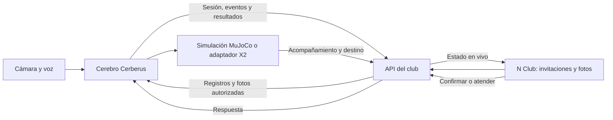

# N Club y Cerberus en vivo

N Club conserva la información operativa y presenta la recepción. El cerebro de Cerberus ejecuta el reconocimiento facial, la lectura de QR y el diálogo. Ambos repositorios se despliegan por separado y se comunican mediante la API del club bajo `/api`.



## Datos y configuración

`CERBERUS_DATA_SOURCE=sabana` selecciona las identidades del equipo: `gabriel` es VIP; `andres` y `thomas` son regulares; `vale` es EXTERNO, según el padrón de `juan-x2-caminar`. Vale conserva su identidad y foto, sin cuenta de socio ni autorización VIP. Su ingreso requiere una orden de servicio vigente vinculada a su identidad desde Personal. Male queda pendiente de captura y registro. Los nombres, IDs y categorías corresponden al padrón de Cerberus. Los correos de acceso son identificadores técnicos con dominio `nclub.demo`, no correos personales. Las cuentas operativas representan funciones del club. `CERBERUS_TEAM_PASSWORD` es obligatorio y se entrega por un canal privado.

Este modo conserva los cinco flujos y deja vacías las actividades, los turnos y las órdenes de ejemplo; los invitados se crean desde la aplicación. Una persona desconocida no recibe una cuenta ni una categoría autorizada por defecto. Los datos de pruebas unitarias permanecen separados del estado operativo.

Las fotografías, cédulas y embeddings no se incorporan al código del repositorio. La app conserva las fotos autorizadas cifradas; el cerebro recibe la imagen mediante una ruta autenticada y calcula el embedding localmente.

## Foto de un invitado

1. El socio crea una invitación y elige **Cámara frontal** o **Galería**.
2. Confirma la autorización para usar la foto y la guarda. La app envía un JPEG mediante `PUT /invitaciones/{id}/foto`.
3. El estado cambia a `PENDIENTE`. El cerebro consulta las fotos pendientes, exige una sola cara y guarda el embedding.
4. El cerebro publica el resultado; la aplicación muestra `LISTA` o `RECHAZADA` y su motivo.
5. Al retirar la foto, cancelar la invitación, vencer su horario o registrar la salida, se retira la contribución correspondiente de la galería. La ficha puede conservarse para el QR mientras la invitación siga vigente.

La foto de perfil de un socio también tiene este ciclo. Retirarla elimina únicamente la contribución importada desde N Club; no elimina otro dataset con autorización independiente.

## Contrato adicional

Todas las rutas BOT requieren `X-Bot-Key`. `CERBERUS_BOT_KEY` conserva el acceso de los clientes existentes; la variable opcional `CERBERUS_BRIDGE_KEY` permite una credencial adicional con los mismos permisos para el puente de Cerberus, sin reemplazar la original. Las rutas de la app requieren JWT. Las claves se mantienen en el servidor y nunca en variables `EXPO_PUBLIC_*`.

| Ruta                     | Función                                                                                                         |
| ------------------------ | --------------------------------------------------------------------------------------------------------------- |
| `GET /bot/pases`         | Payloads QR vigentes para sincronizar los PNG del computador.                                                   |
| `GET /bot/personas`      | Identidades conocidas, categorías y estado de foto; incluye externos sin concederles acceso.                    |
| `GET /bot/registros`     | Padrón, agenda, turnos y órdenes vigentes. La agenda incluye `hora_hasta`, `foto_estado` y `consentimiento_at`. |
| `POST /bot/sesion`       | Última fase y mensaje del robot, con `sesion_id` y secuencia creciente.                                         |
| `GET /robot/sesion`      | Sesión para concierge/administración y señal de datos desactualizados.                                          |
| `POST /bot/qr/verificar` | Firma, vencimiento y correspondencia del QR con el registro vigente.                                            |

La sesión admite fases de espera, identificación, reintento, QR, confirmación, orientación, acompañamiento, destino, recepción y salida. Incluye metadatos operativos; no transporta imágenes, audio ni embeddings. La pantalla consulta la sesión aproximadamente cada 1,2 segundos mientras está activa y marca datos desactualizados después de 15 segundos sin actualización.

Se reutilizan las rutas de fotos, eventos, confirmaciones, visitas y latido descritas en [CLUB.md](CLUB.md). El formato QR sigue siendo `NCLUB1|tipo|persona_id|nombre|exp|firma`. El nombre y el ID son legibles: la firma garantiza integridad, no confidencialidad. La categoría y la vigencia también se contrastan con los registros.

## Ejecución local

En este repositorio:

```bash
npm ci
npm run build:web:api
```

Con ambos repositorios como carpetas hermanas, desde SABANAHACK2026 y su entorno Python instalado:

```bash
python tools/nclub_local.py --web ../Nogal
python tools/nclub_local.py --accesos
```

El primer comando mantiene ambos servicios activos y crea claves privadas locales y una base SQLite bajo la carpeta de datos excluida de Cerberus. El segundo muestra las credenciales locales. `Ctrl+C` detiene los procesos iniciados por el arranque.

Para añadir la simulación, usar `--sim`. El cerebro sigue siendo un servicio local; no se expone su API biométrica sin autenticación a Internet. En Vercel se publica N Club y su API, con Upstash configurado como almacenamiento compartido; el proceso Python conecta hacia esa API por HTTPS. El modo integrado rechaza una configuración Vercel basada solo en memoria o SQLite local. En Upstash utiliza el prefijo `sabana:` para conservar separado el estado de la demostración anterior, sin borrarlo.

## Verificación y límites

`npm run verify` comprueba privacidad, dependencias, formato, tipos, pruebas, compilación y recorridos de navegador. Estas comprobaciones no sustituyen la prueba del circuito de fotos, reconocimiento, confirmación y acompañamiento con las dos APIs funcionando.

La simulación conserva el arnés virtual del X2. La integración de software no certifica locomoción autónoma ni valida el hardware físico. Las fotos del equipo y el modelo de voz deben estar disponibles en el equipo del cerebro; no se descargan modelos al iniciar el arranque local.

## Celular y robot fijo

El celular usa esta web desplegada y el computador consulta la API por HTTPS. El proceso Python se arranca con `tools/nclub_local.py --club-api https://n-club-five.vercel.app/api --config robotB/datos/nclub-remoto/config.json`. El JSON permanece privado: su campo `CERBERUS_BOT_KEY` contiene la credencial adicional configurada como `CERBERUS_BRIDGE_KEY` en Vercel. Las claves JWT, de fotografías y de firma QR permanecen exclusivamente en el servidor. Sin `--sim`, Brain selecciona recepción fija: reconoce y saluda; no declara acompañamientos ni desplazamientos físicos. Las orientaciones y respuestas de voz aparecen en la sesión del robot.

Los QR vigentes se sincronizan por `GET /bot/pases` y se guardan en `robotB/pases/nclub/` del computador; las invitaciones canceladas o vencidas se retiran de esa copia. La versión con MuJoCo utiliza las mismas APIs y representa el recorrido.

## Actividad de Juan X2

La integración incorpora el control y la interacción de `juan-x2-caminar` sin sustituir la simulación ni el puente existente. El cliente X2 comunica telemetría AimDK a Brain cada cinco segundos. Brain conserva en SQLite los eventos que aún no se han entregado y transmite únicamente las métricas permitidas. Las lecturas de estado se agrupan por robot y origen para evitar acumular muestras repetidas durante una caída de red.

| Ruta                             | Acceso y contenido                                                                                                                                               |
| -------------------------------- | ---------------------------------------------------------------------------------------------------------------------------------------------------------------- |
| `POST /bot/telemetria`           | BOT: estado, movimiento, obstáculos, fallos, gestos, respuestas de voz, registro y generación de QR.                                                             |
| `GET /robot/telemetria`          | Concierge/Administración: último estado, actividad reciente y señal de desactualización.                                                                         |
| `POST /bot/personas`             | BOT: alta o actualización de identidades locales VIP/REGULAR con consentimiento explícito; la baja elimina estos metadatos. Los IDs del padrón están reservados. |
| `GET /robot/personas`            | Concierge/Administración: identidades adicionales registradas desde el robot.                                                                                    |
| `POST /bot/personas/{id}/foto`   | BOT: foto autorizada de un externo conocido, con el mismo cifrado y procesamiento facial del resto de perfiles; registra la fecha del consentimiento.            |
| `DELETE /bot/personas/{id}/foto` | BOT: revoca la foto compartida del externo y elimina su consentimiento asociado.                                                                                 |
| `GET /servicios/personas`        | Personal/Administración: externos conocidos para vincular una orden real.                                                                                        |

Cada mensaje de actividad lleva `id` UUID, `robot`, `origen` (`real` o `simulacion`), `tipo`, `observado_at` y `mensaje`; opcionalmente, `persona_id` y métricas `datos`. Se rechazan campos desconocidos, fotografías, payloads QR y fechas más de dos minutos en el futuro. El estado se considera desactualizado tras quince segundos sin recepción. La bitácora conserva hasta cien eventos de las últimas veinticuatro horas; la deduplicación cubre los doscientos UUID más recientes. No sustituye el historial de visitas y eventos de atención.

La batería, FSM, acción y códigos de alerta solo se muestran si sus tópicos AimDK reportaron en los últimos quince segundos. La velocidad recibida es una orden al controlador, no una medición de desplazamiento. Una solicitud de caminar o de gesto no acredita su ejecución; el cambio de FSM informa el modo del controlador. No se deduce una caída ni un contacto con personas de esos datos: estos eventos requieren una fuente que los reporte explícitamente.

MuJoCo usa el mismo canal y etiqueta toda su actividad como simulación. Publica inicio de desplazamiento solo después de observar un cambio de posición en su propio mundo. El panel web consulta la actividad aproximadamente cada 1,2 segundos mientras está visible y conserva la última información con aviso si se pierde la conexión. El latido de Brain se presenta separado de la telemetría del X2.

El catálogo facial no reemplaza la autorización: Vale puede reconocerse como externa, pero sin una orden de servicio en estado PROGRAMADA o EN_CURSO, dentro de su fecha y horario, se deriva a recepción. Los antiguos QR de socio de Vale quedan rechazados. No se crean órdenes, empresas, apellidos ni horarios ficticios para completar su ficha.

Las fotos de perfil se conservan hasta su revocación; las fotos de invitados mantienen la retención por visita. La revocación de N Club retira su contribución facial del cerebro y conserva cualquier dataset independiente que cuente con su propia autorización. La lectura de cédulas digitales requiere un motor OCR disponible en el equipo del cerebro; no forma parte del despliegue web de Vercel.
