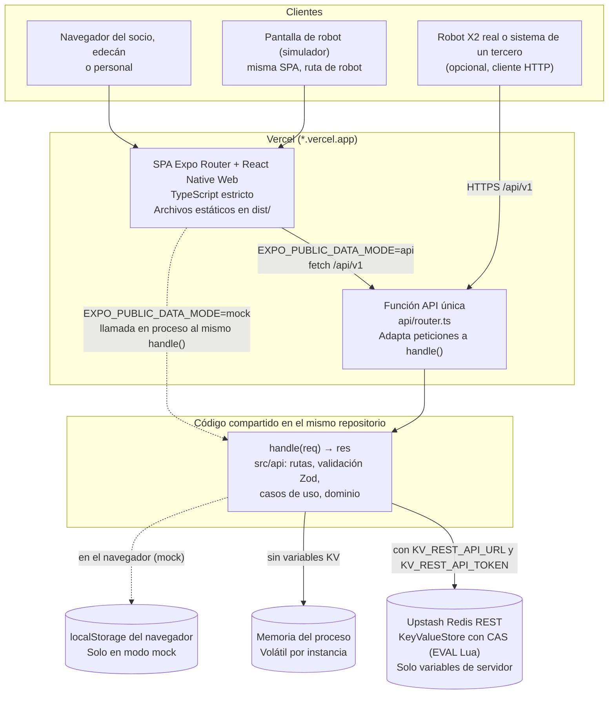

# C4 nivel 2: contenedores

Arquitectura del MVP tal como está implementada. Es un monolito modular desplegado en Vercel (`https://n-club-five.vercel.app`): una SPA estática y una única función serverless que expone la API propia. Decisiones: `docs/adr/0001-architecture.md` y `docs/adr/0002-mocks-api.md`.

## Diagrama

Las flechas punteadas son rutas del modo `mock`; las sólidas, del modo `api`.

## Contenedores

| Contenedor             | Tecnología                                                                     | Responsabilidad                                                                                                                                                                                                                          | Datos que toca                                                                                                                                                                                                          | Confianza                                                                           |
| ---------------------- | ------------------------------------------------------------------------------ | ---------------------------------------------------------------------------------------------------------------------------------------------------------------------------------------------------------------------------------------- | ----------------------------------------------------------------------------------------------------------------------------------------------------------------------------------------------------------------------- | ----------------------------------------------------------------------------------- |
| SPA                    | Expo SDK 58, Expo Router, React Native Web, TypeScript, `web.output: "single"` | Interfaz por rol (socio, robot, edecán, personal). Presenta; no decide reglas de negocio.                                                                                                                                                | Estado de UI y copia de respuestas de la API.                                                                                                                                                                           | No confiable. Solo variables `EXPO_PUBLIC_*`, sin secretos.                         |
| Función API            | Función Vercel única `api/router.ts` (`vercel.json` le reescribe `/api/v1/*`)  | Traduce la petición HTTP de Vercel a `handle()` y devuelve la respuesta. La composición (almacén y variables) está en `src/api/server.ts`.                                                                                               | Variables de servidor `KV_REST_API_URL`, `KV_REST_API_TOKEN`, `CERBERUS_ROBOT_TOKEN`, `CERBERUS_RESET_ENABLED`.                                                                                                         | Frontera de confianza del servidor.                                                 |
| `handle()` (`src/api`) | TypeScript sin dependencias de plataforma                                      | Enrutado bajo `/api/v1`, validación con esquemas Zod, casos de uso, dominio, idempotencia, límite de tasa, token opcional de robot, consulta pública del pase (`GET /passes/{token}`), cabecera `X-Cerberus-Storage` y errores estables. | Lee y escribe mediante el puerto `KeyValueStore`.                                                                                                                                                                       | Mismo código en servidor y, en modo mock, en el navegador.                          |
| Upstash Redis          | Redis administrado, API REST llamada con `fetch`                               | Persistencia compartida entre dispositivos y entre instancias de la función; compare-and-set atómico.                                                                                                                                    | Visitas (con invitación y relevos), índices (`visits:ids`, `hostday:`, `qr:`, `inv:`, `handoff:`), reservas (`person:`, `escort:`), estado de robots (`robot:`), claves de idempotencia y contadores de límite de tasa. | Solo accesible desde el servidor.                                                   |
| Memoria del proceso    | `Map` en la instancia                                                          | Persistencia de pruebas y desarrollo; respaldo cuando no hay Redis.                                                                                                                                                                      | Igual que Redis.                                                                                                                                                                                                        | Volátil: cada instancia serverless tiene su propia copia y se pierde al reciclarse. |
| localStorage           | Web Storage del navegador                                                      | Persistencia del modo mock, rotulada "Demo local".                                                                                                                                                                                       | Igual que Redis, solo para ese navegador.                                                                                                                                                                               | El usuario del navegador puede leerla y editarla: no hay garantía de integridad.    |

## Qué cambia entre modos

| Aspecto                                | `mock`                    | `api` con memoria                                                 | `api` con Redis                    |
| -------------------------------------- | ------------------------- | ----------------------------------------------------------------- | ---------------------------------- |
| Quién ejecuta `handle()`               | El navegador              | La función Vercel                                                 | La función Vercel                  |
| Almacén                                | localStorage              | Memoria (volátil)                                                 | Upstash Redis                      |
| Estado compartido entre dispositivos   | No                        | No (ni siquiera entre peticiones si caen en instancias distintas) | Sí                                 |
| `GET /api/v1/health` informa `storage` | `browser`                 | `memory`                                                          | `redis`                            |
| Línea de estado en la portada          | «Modo demostración local» | «Modo API · almacenamiento: memory»                               | «Modo API · almacenamiento: redis» |

## Despliegue y variables

| Variable                               | Ámbito                      | Uso                                                                                                                                                                                         |
| -------------------------------------- | --------------------------- | ------------------------------------------------------------------------------------------------------------------------------------------------------------------------------------------- |
| `EXPO_PUBLIC_DATA_MODE`                | Cliente (pública)           | `mock` o `api`; se resuelve al construir la aplicación.                                                                                                                                     |
| `EXPO_PUBLIC_API_URL`                  | Cliente (pública, opcional) | Origen de la API; por defecto el mismo origen.                                                                                                                                              |
| `KV_REST_API_URL`, `KV_REST_API_TOKEN` | Servidor                    | Credenciales de Upstash. Con ambas definidas el almacén es Redis. También se aceptan `UPSTASH_REDIS_REST_URL` y `UPSTASH_REDIS_REST_TOKEN`. Nunca con prefijo `EXPO_PUBLIC_`.               |
| `CERBERUS_ROBOT_TOKEN`                 | Servidor (opcional)         | Token Bearer que exigen `POST /recognition/events`, `POST /access/verify` y `POST /robots/{id}/failure`. Sin la variable no se exige nada; definida pero vacía, deniega todo. Implementado. |
| `CERBERUS_RESET_ENABLED`               | Servidor                    | `false` (cualquier valor distinto de `true`) desactiva `POST /api/v1/demo/reset`. Por defecto está habilitado. `CERBERUS_DEMO_RESET=off` es el nombre anterior y también lo desactiva.      |
| `CERBERUS_RATE_LIMIT`                  | Servidor local de pruebas   | `off` desactiva el límite de tasa. Solo para `npm run serve`; no debe definirse en el despliegue.                                                                                           |
| `VERCEL_GIT_COMMIT_SHA`                | Servidor (lo define Vercel) | `GET /api/v1/health` lo expone como `commit`; el smoke posterior al despliegue espera ese valor.                                                                                            |

Upstash Redis está conectado en el despliegue de demostración: `GET /api/v1/health` informa `storage: "redis"` y toda respuesta lleva `X-Cerberus-Storage: redis`.

La integración continua (`.github/workflows/ci.yml`: auditoría, secretos, formato, lint, tipos, cobertura, integración, build y E2E) corre en cada pull request y en cada push a `main`. Tras un CI exitoso, `.github/workflows/smoke.yml` espera a que producción sirva ese commit y ejecuta las pruebas de humo contra el despliegue. Vercel despliega desde el repositorio; por sí solo no garantiza que las pruebas hayan pasado.
