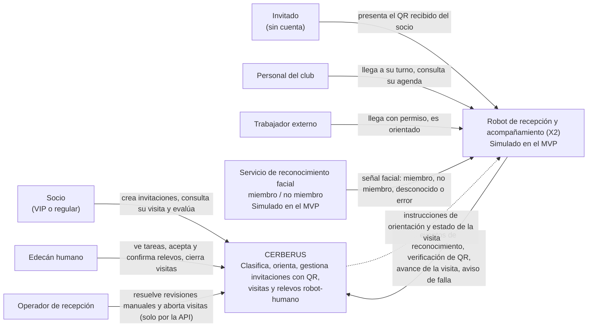

# C4 nivel 1: contexto del sistema

Cerberus es el sistema que clasifica a cada persona que llega al club en una de cinco categorías (VIP, regular, invitado, personal del club, trabajador externo), la orienta y, si el robot falla, traspasa la visita a un edecán humano sin perder el contexto.

Este documento describe la arquitectura del MVP implementado. Las decisiones que lo sustentan están en `docs/adr/`.

## Diagrama

## Actores y sistemas

| Elemento                                 | Tipo                     | Relación con Cerberus                                                                                                                                                                              |
| ---------------------------------------- | ------------------------ | -------------------------------------------------------------------------------------------------------------------------------------------------------------------------------------------------- |
| Socio                                    | Persona (cuenta demo)    | Registra invitados para una fecha, obtiene el QR temporal, recibe orientación y puede evaluar el servicio.                                                                                         |
| Invitado                                 | Persona sin cuenta       | Recibe del socio un QR temporal; no se registra en el sistema. Se identifica ante el robot o el edecán.                                                                                            |
| Personal del club                        | Persona (cuenta demo)    | Es reconocido como "no miembro" por el sistema facial; se confirma con el directorio de personal y su turno.                                                                                       |
| Trabajador externo                       | Persona con permiso      | Se confirma con un permiso de ventana semanal (por ejemplo, sábados de 08:00 a 17:00) y una orden de trabajo.                                                                                      |
| Edecán humano                            | Persona (cuenta demo)    | Atiende tareas de acompañamiento y recibe relevos cuando un robot no puede continuar.                                                                                                              |
| Operador de recepción                    | Actor de la API (`O-01`) | No tiene pantalla propia en el MVP. Puede resolver revisiones manuales y abortar visitas mediante la API; el kiosco solo lo usa para leer las invitaciones que ofrecen los atajos del presentador. |
| Robot de recepción y acompañamiento (X2) | Sistema externo          | Hardware real si está disponible; en el MVP lo reemplaza una pantalla de robot que se comporta como cliente de la API pública.                                                                     |
| Servicio de reconocimiento facial        | Sistema externo          | Entrega una señal inicial (miembro, no miembro, desconocido, error). En el MVP se simula y se rotula como simulación. Cerberus no almacena imágenes ni plantillas biométricas.                     |

## Límites de confianza

- La señal facial es una pista, no una autorización: la categoría y los permisos se confirman siempre con registros del servidor (ADR 0003).
- El QR es un token opaco; su validez se decide únicamente en el servidor (ADR 0004).
- Los clientes (SPA, robot, simuladores) son no confiables: no deciden clasificación, vigencia ni responsable de una visita.
- En el MVP no hay autenticación real: los perfiles se eligen en un selector de demostración y todos los datos son ficticios (ADR 0002).
